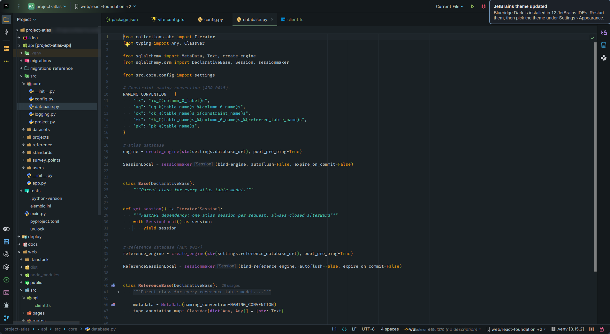
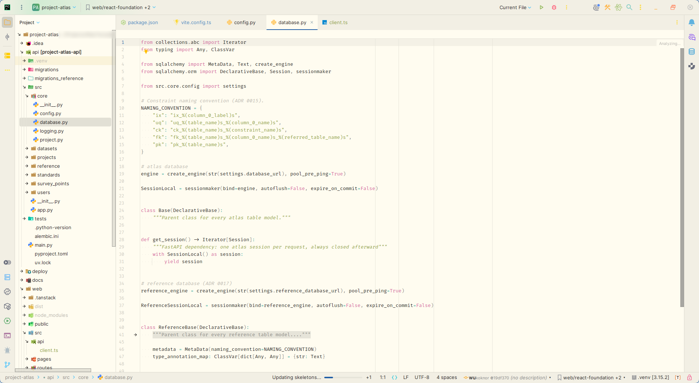
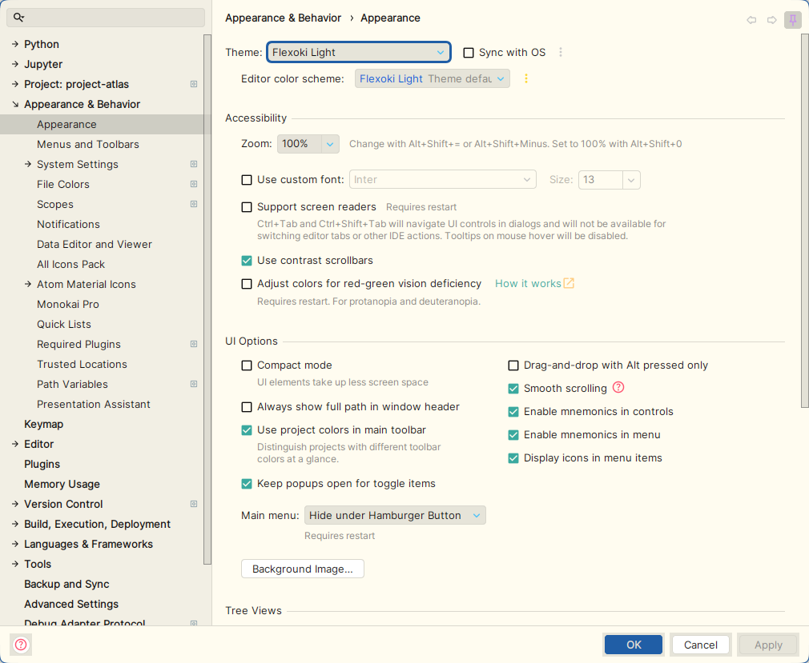

# Omarchy Theme Generator for JetBrains IDEs

Give your JetBrains IDEs (PyCharm, IntelliJ IDEA, WebStorm, GoLand, CLion, RustRover, DataGrip,
PhpStorm, …) the same colors as your [Omarchy](https://omarchy.org) desktop theme.

It works two ways:

- **As an Omarchy plugin:** a background service that builds a matching JetBrains theme for
  the Omarchy theme you have applied, and installs it into every JetBrains IDE you use. It does
  this again each time you switch themes.
- **As a command-line tool:** `generate.py` builds a theme plugin `.jar` from any Omarchy
  theme, so you can install it yourself or share it.

Each generated theme includes:

- **A UI theme** (`.theme.json`) that styles windows, tool windows, tabs, popups, buttons,
  inputs, progress bars, notifications, version control and debugger colors. Light themes
  get a light UI.
- **An editor color scheme** (`.icls`) with syntax colors (Python plus shared defaults,
  HTML/XML, CSS, JSON/YAML/TOML, Markdown, SQL, shell), console and ANSI colors, diff and VCS
  markers, search highlights, and error and warning effects.

The UI theme links to its color scheme, so picking the theme also switches the editor colors.

| Blueridge Dark, with the "theme updated" notification | Flexoki Light |
|---|---|
|  |  |

## Install as an Omarchy plugin

```bash
omarchy plugin add https://github.com/hbabb/omarchy-jetbrains --enable
```

Or from the desktop: open the Omarchy menu and go to *Setup › Plugins › Add Plugin*.

Once it's enabled, the service right away builds a theme from your current Omarchy theme and
installs it into each JetBrains IDE.

Each time you run `omarchy theme set …`, the matching JetBrains theme is built and installed in
the background, and a notification tells you when there's a new theme to pick.

### Use the theme in your IDE

1. **Restart the IDE.** JetBrains IDEs only load new themes at startup. Any of these works:
   - **Menu:** *File → Restart IDE*.
   - **Find Action:** press `Ctrl+Shift+A` (this is the shortcut with the VS Code keymap),
     type `Restart IDE`, and press Enter.
   - Quit the IDE completely and start it again. Closing the project window isn't enough.
2. **Pick the theme in Settings.** Open Settings (`Ctrl+Alt+S`) → Appearance & Behavior →
   Appearance → *Theme*. The theme has the same name as your Omarchy theme, for example
   *Forest Night*. Its color scheme is selected automatically, and it's also listed under
   Editor → Color Scheme.

The generated themes **only appear in Settings**. They aren't listed in the IDE's theme
switcher, which shows themes that are installed as Marketplace plugins.



### What it changes

- It writes `omarchy-theme-<theme>.jar` into each IDE's plugin directory,
  `~/.local/share/JetBrains/<Product><version>/`. It creates that directory for IDEs that
  have a config directory in `~/.config/JetBrains/` but no plugin directory yet.
- It keeps its build output in `~/.cache/omarchy-jetbrains/`. That includes a standalone
  `<Theme Name>.icls` for each theme, which you can import with Settings → Editor → Color
  Scheme → ⚙ → *Import Scheme…* if you only want the editor colors.
- Updates also rebuild any older `omarchy-theme-*.jar` it installed before, so fixes reach
  themes you aren't currently using.
- It **never** changes which theme or color scheme an IDE uses, and never edits IDE settings.
  You choose the theme yourself.
- It runs entirely as your user without root privileges, never uses the network, and doesn't
  run anything when a plugin update is downloaded.

Each Omarchy theme you switch to adds its own JetBrains theme, so all of them stay available in
the IDE's theme list.

### Settings

To turn off the notification, add or edit the plugin's entry in `~/.config/omarchy/shell.json`:

```json
{ "plugins": [ { "id": "io.github.hbabb.omarchy-jetbrains", "notify": false } ] }
```

To rebuild and reinstall on demand: `omarchy-shell omarchy-jetbrains sync`.

### Update

```bash
omarchy plugin update io.github.hbabb.omarchy-jetbrains
```

### Remove

```bash
omarchy plugin remove io.github.hbabb.omarchy-jetbrains

# Optional: remove the generated JetBrains themes and the build cache
rm -f ~/.local/share/JetBrains/*/omarchy-theme-*.jar
rm -rf ~/.cache/omarchy-jetbrains
```

Restart your IDEs after removing the jars. If an IDE was using one of the themes, it switches
back to its default theme.

### Troubleshooting

- **The theme isn't listed:** restart the IDE (see [Use the theme in your IDE](#use-the-theme-in-your-ide))
  and look in Settings → Appearance, not the theme switcher. If it's still missing, check that
  `~/.local/share/JetBrains/<IDE>/omarchy-theme-<theme>.jar` exists, or run
  `omarchy-shell omarchy-jetbrains sync`.
- **The editor color scheme is missing:** each theme's color scheme is listed under
  Settings → Editor → Color Scheme with the same name as the theme. Jars built before
  version 1.0.1 packaged the scheme in a way the IDE ignores (its log says *Theme X refers to
  unknown color scheme /themes/X.icls*). Update the plugin, run
  `omarchy-shell omarchy-jetbrains sync`, and restart the IDE.
- **The same theme is listed twice, or the IDE warns about a duplicate plugin:** delete any
  jar you installed by hand from `build/` (for example `ForestNight.jar`). The plugin's
  `omarchy-theme-<theme>.jar` uses the same plugin ID.

## Dependencies

- Omarchy (Quattro) with the Omarchy shell
- Python 3.11 or newer (`python3`; uses the standard-library `tomllib`, nothing else to
  install)
- A JetBrains IDE, build 242 (2024.2) or newer. IDEs installed through Toolbox or by hand
  both work, since both keep their plugins under `~/.local/share/JetBrains/`.

## Command-line use

You don't need the plugin to use the generator:

```bash
# By Omarchy theme name (checks ~/.config/omarchy/themes and the stock themes)
python3 generate.py asia-neon
python3 generate.py forest-night

# The theme Omarchy has applied right now, installed into every JetBrains IDE
python3 generate.py --current --install

# Any colors.toml, with an optional display name
python3 generate.py path/to/colors.toml --name "My Theme"
```

| Option | Meaning |
|---|---|
| `--current` | Use the theme Omarchy has applied (`~/.local/state/omarchy/current`) |
| `--install` | Copy the jar into every JetBrains IDE as `omarchy-theme-<slug>.jar` |
| `--out DIR` | Build directory (default `./build`) |
| `--json` | Print a machine-readable summary |
| `--name` | Display name (default: from the theme name) |

Output goes to `<out>/<theme-slug>/`:

```
build/forest-night/
├── ForestNight.jar          # installable plugin (UI theme + color scheme)
├── ForestNight.theme.json   # the UI theme, for inspection
└── Forest Night.icls        # color scheme only, importable on its own
```

To install a jar by hand, go to Settings → Plugins → ⚙ → *Install Plugin from Disk…* and
restart. To use only the color scheme, go to Settings → Editor → Color Scheme → ⚙ →
*Import Scheme…*.

## Supported themes

Any Omarchy theme works:

- Current themes with a `colors.toml`, dark or light.
- Older themes that only define `color0`–`color15`, or only ship an `alacritty.toml`.
- Optional colors a theme leaves out (orange, the background shades, muted, selection, the
  bright colors) are filled in from the colors it does have.

These have hand-tuned syntax colors:

| Omarchy theme | Syntax colors |
|---|---|
| `asia-neon` | Default palette mapping: magenta keywords, neon-green strings, blue functions, yellow classes, cyan decorators |
| `forest-night` | Profile copied from the *Forest Night – Ethereal* VS Code theme: amber keywords, teal strings, purple functions, rose types, sage constants |

## How it works

1. The theme's palette (backgrounds, foregrounds, accent, selection, muted and the terminal
   colors) is loaded, missing colors are filled in, and the colors are blended to get hover,
   border and caret-row shades.
2. Syntax colors are set by **role** in the `R` dict (`keyword`, `string`, `func_decl`,
   `klass`, `decorator`, …), with defaults taken from the palette.
3. If the theme's name appears in `PROFILES`, that profile overrides any of those roles. Use
   a profile when a palette repeats colors (Forest Night's `blue` is the same as its `cyan`),
   or when you want to match an existing editor theme exactly.
4. The roles feed the `.icls` attributes and the named colors in `.theme.json`. Both files are
   packed into a jar with a `plugin.xml` that registers a `themeProvider`. The jar is built
   with fixed timestamps, so rebuilding an unchanged theme produces the same file and
   reinstalling it does nothing.
5. The Omarchy plugin (`Service.qml`) watches `~/.local/state/omarchy/current/theme.name` and
   runs `generate.py --current --install --json` when it changes.

### Adding a profile for a new theme

```python
PROFILES = {
    "my-theme": dict(
        keyword="ff7a93", string="9ece6a", func_decl="7aa2f7",
        # ...only the roles you want to change
    ),
}
```

If the Omarchy theme comes from a VS Code theme, copy its `tokenColors` and use them as the
source for the profile (see the `forest-night` entry).

## Credits

- [Omarchy](https://omarchy.org) for the theme system and `colors.toml` format.
- [Asia Neon](https://github.com/sspaeti/omarchy-asia-neon-theme) by sspaeti.
- [Forest Night](https://github.com/ForrestKnight/omarchy-forest-night-theme) and its
  *Forest Night – Ethereal* VS Code theme by ForrestKnight.

This project is not affiliated with Omarchy, JetBrains or the theme authors.

## Contributing

See [CONTRIBUTING.md](CONTRIBUTING.md).

## License

[MIT](LICENSE)
